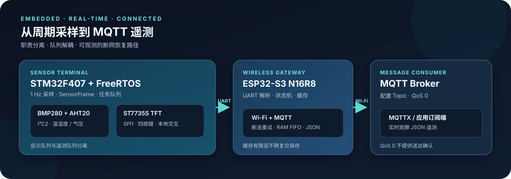

<div align="center">

# STM32F407 + FreeRTOS 环境遥测终端

**双 MCU 环境监测与 MQTT 遥测项目**<br>
F407 负责传感器采集和 TFT 本地交互，ESP32-S3 负责 Wi-Fi 与 MQTT；两端通过 UART 分工。

[](https://github.com/mamorrozer/f407-freertos-esp32-telemetry/actions/workflows/host-tests.yml)




</div>

## 项目简介

这是一个以 FreeRTOS 为核心的双 MCU 环境遥测项目。STM32F407 周期采集 BMP280 和 AHT20，通过任务队列把数据分别交给 TFT 显示和 UART 遥测；ESP32-S3 解析遥测帧，经 Wi-Fi 发布到 MQTT Broker。

```text
BMP280 / AHT20 → STM32F407 + FreeRTOS → UART → ESP32-S3 → Wi-Fi / MQTT → MQTTX
```

## 项目亮点

- **任务职责清晰**：采集、显示、遥测和健康信息由独立任务处理；队列把采样与屏幕刷新、串口发送解耦。
- **通信可观测**：UART 支持便于调试的文本行和带校验的二进制帧；ESP32 统计解析、序号间隔、缓存和发布结果。
- **断网有恢复路径**：ESP32 使用有限容量的 RAM FIFO 暂存并重试遥测；网络恢复后观察到缓存继续发送。
- **可在主机验证**：传感器驱动、帧协议、缓存、配置与投递模块有 CMake/CTest 主机测试。

> 缓存位于 RAM，ESP32 复位或掉电后不会保留；队列满时可能丢弃数据。当前 MQTT 使用 QoS 0，发布 API 接受数据不等同于 Broker 或订阅端确认收到。

## 当前实现范围

| 状态 | 内容 |
|---|---|
| **板上运行** | F407 传感器采集、FreeRTOS 任务/队列、ST7735S TFT、四按键、UART 遥测；ESP32-S3 Wi-Fi/MQTT、解析与有限 RAM 缓存 |
| **主机测试/独立模块** | 遥测故障注入、存储适配、功耗策略和部分健康/统计模块；它们不都属于当前默认固件功能 |
| **不随仓库发布** | 本机 `sdkconfig`、Wi-Fi/MQTT 凭据、构建目录、烧录产物和本机 IDE 设置 |

仓库按阶段保留了可复用和测试中的模块。进入 `stage6`、`stage7` 不代表模块已全部集成到板上固件；各目录状态见[仓库结构](#仓库结构)和[架构说明](docs/ARCHITECTURE.md)。

## 验证记录

| 验证项 | 已记录结果 |
|---|---|
| 主机测试 | 19 个 CTest 项；GitHub Actions 已配置为在 `main` 分支推送和 PR 时构建并运行 |
| STM32F407 | 发布副本曾用 GNU Arm Embedded GCC 13.3.1 成功构建；镜像约 44.9 KiB Flash、14.9 KiB RAM |
| ESP32-S3 | 发布副本曾用 ESP-IDF v5.4 成功构建；应用镜像 `0xDA220` 字节，目标分区为 1 MiB |
| 实机观察 | TFT 显示、UART 到 MQTT 收发以及一次网络中断后的重连/缓存恢复均有记录；长时间断网曾观察到缓存溢出 |

历史测试的设备、指标边界和复现步骤见[验证记录](docs/VERIFICATION.md)。本地历史结果不代表所有构建选项或故障情形都已测试。

## 硬件与接口

| 设备 | 连接 |
|---|---|
| BMP280 + AHT20 | F407 I2C2：PB10=SCL，PB11=SDA |
| ST7735S TFT | F407 SPI1：PA5=SCK，PA7=MOSI，PA4=CS，PB0=RST，PB1=DC，PB12=BL |
| 四个按键 | PB6–PB9，低电平有效 |
| F407 ↔ ESP32-S3 UART1 | PA9/TX → GPIO18/RX；PA10/RX ← GPIO17/TX；两板共地，3.3 V UART |

实测主控为嘉立创天空星 STM32F407VE 和 ESP32-S3 N16R8。不同模块的供电与逻辑电平要求可能不同；接线前核对模块规格，不要默认外设可承受 5 V。

## 构建、烧录与使用

从这里开始：

1. [构建与烧录指南](docs/BUILD_AND_FLASH.md)：F407、ESP32-S3、主机测试和 MQTTX 订阅步骤。
2. [架构说明](docs/ARCHITECTURE.md)：任务边界、数据路径和可靠性限制。
3. [学习路线](docs/LEARNING_GUIDE.md)：按源码阅读顺序理解 FreeRTOS 与双 MCU 通信。
4. [验证记录](docs/VERIFICATION.md)：已有硬件观察、构建记录和未覆盖边界。

F407 默认使用可读文本遥测格式。与 ESP32 的二进制帧模式联调时，按构建指南设置 `F407_TELEMETRY_BINARY_TX=1`。ESP32 网络参数通过本机 `idf.py menuconfig` 配置；生成的 `sdkconfig` 不应提交。

## 仓库结构

| 路径 | 用途与状态 |
|---|---|
| `stage2/F407_SensorTerminal/` | 当前 F407 FreeRTOS 固件、TFT 界面和硬件驱动 |
| `stage2/common/` | F407 与 ESP32 共用的遥测数据定义和桥接代码 |
| `stage2/aht20/`, `stage2/bmp280/` | 独立传感器驱动/测试版本；集成固件代码在 F407 工程的 `Core/Src/` |
| `stage3/esp32s3_mqtt_node/` | 当前 ESP-IDF 应用和 MQTT 组件 |
| `stage4/` | 遥测协议与故障注入模块 |
| `stage6/` | 缓存和存储相关模块；存储部分是独立验证代码 |
| `stage7/` | 配置、投递、健康、统计与功耗策略模块，部分为独立验证代码 |
| `host_tests/` | 不依赖 MCU 硬件的 CMake/CTest 测试 |
| `docs/` | 架构、构建、学习、验证和示意图 |
| `LICENSES/` | FreeRTOS、ST 和 Arm 第三方许可证文本 |
| `.github/workflows/` | 主机测试的 GitHub Actions 工作流 |

## 许可

项目原创代码采用 MIT 许可。STM32 HAL、CMSIS 和 FreeRTOS 等随仓库提供的第三方代码仍适用各自上游许可，详见 [`THIRD_PARTY_NOTICES.md`](THIRD_PARTY_NOTICES.md) 与 [`LICENSES/`](LICENSES/)；不要将仓库根目录的 MIT 许可理解为重新许可这些组件。
